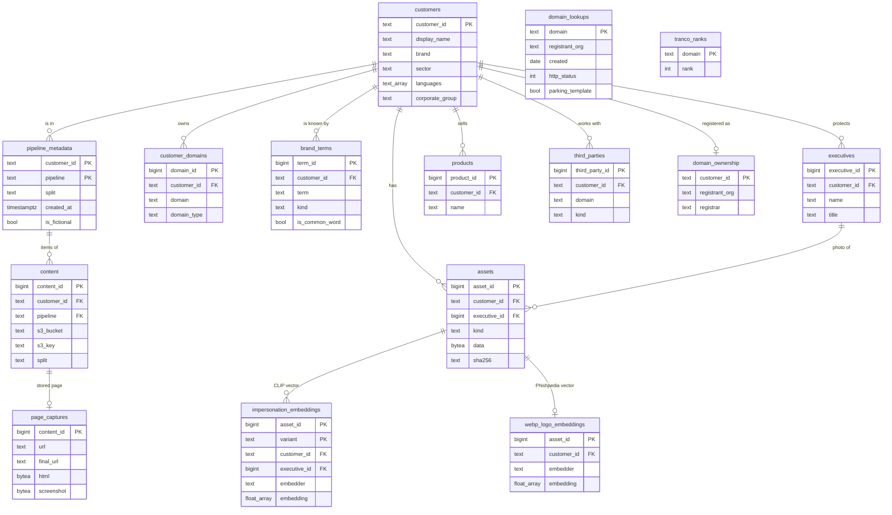

# Data schema

What is stored where, and what the APIs expect. Read from the live RDS and S3 on 2026-11-17.

- **RDS** (PostgreSQL `customerdata`, schema `drp_clients`): everything the services *look up at request time*: clients, their domains, brand words, logos, executive photos, embeddings, and the stored page captures.
- **S3** (bucket `drp-pipeline`): the *raw benchmark items and their labels*: screenshots, link lists, message texts, domain lists. The services do not read S3 when they answer a request.
- **The link between them:** `drp_clients.content` has one row per S3 object (`s3_bucket` + `s3_key`).

The other schemas in the same database (`public`, `holdout`, `bak_20260814`, `bak_v2_20260818`) are not used by the services and were not touched.

---

## 1. RDS: `drp_clients`

### 1.1 Tables

| Table | Rows | Primary key | What it holds |
|---|---:|---|---|
| `customers` | 35 | `customer_id` | One row per client. `customer_id` is a text slug (`1_1_ionos`, `adobe`, `amazon`, `apexmutual`, …). Columns: `display_name`, `brand`, `sector`, `languages[]`, `corporate_group` |
| `pipeline_metadata` | 60 | `customer_id, pipeline` | Which client belongs to which pipeline: `impersonation` (25), `webp` (25), `susdom` (10). Also `split` (train/val/test, null for webp), `created_at`, `is_fictional` |
| `customer_domains` | 346 | `domain_id` (unique `customer_id, domain, domain_type`) | A client's domains. `domain_type`: `main` 35, `allowlist` 199, `defensive` 70, `regional` 11, `user_content` 27, `owned_tld` 4 |
| `brand_terms` | 127 | `term_id` (unique `customer_id, kind, term`) | Words that identify the brand. `kind`: `alias` 82, `full_brand` 38, `brand_part` 7. `is_common_word` flags generic words |
| `executives` | 87 | `executive_id` (unique `customer_id, name`) | Protected executives: `name`, `title` |
| `products` | 30 | `product_id` | Client products: `name`, `description` |
| `third_parties` | 64 | `third_party_id` | Resellers, agents, franchisees, partners: `domain`, `org`, `kind` |
| `assets` | 625 | `asset_id` (unique `customer_id, kind, sha256`) | Image files stored in the database (`data` bytea), with `mime_type`, `sha256`, size, `executive_id` for photos. `kind`: `logo` 470, `executive_photo` 50, `homepage_screenshot` 37, `login_screenshot` 33, `wordmark` 25, `favicon` 10 |
| `impersonation_embeddings` | 100 | `asset_id, variant` | CLIP (`openai/clip-vit-base-patch32`) vectors for logos (`logo_on_white_100`, `logo_on_white_78`) and executive photos (`photo_as_is`) |
| `webp_logo_embeddings` | 460 | `asset_id` | Phishpedia (BiT) logo vectors, used by WebPhish |
| `content` | 33,205 | `content_id` (unique `s3_bucket, s3_key`) | Index of the benchmark items: `customer_id`, `pipeline`, `s3_bucket`, `s3_key`, `received_at`, `split`. Per pipeline: `impersonation` 4,470, `webp` 6,619, `susdom` 2,923, `physical_threat` 19,193 (no client) |
| `page_captures` | 6,619 | `content_id` | The stored page for each web-phish link: `url`, `final_url`, `html` (bytea), `screenshot` (bytea). A link can be captured more than once, giving more than one `content_id` for the same client and `url` |
| `domain_lookups` | 2,923 | `domain` | Suspicious-domain lookups (RDAP, DNS, HTTP, certificate and page-content flags). Read by the suspicious-domain API: one stored lookup per domain |
| `domain_ownership` | 10 | `customer_id` | The registrant organisation of a client's own domains (susdom); the suspicious-domain API reads it |
| `tranco_ranks` | 71 | `domain` | Popularity rank of well-known domains (susdom); read by the suspicious-domain API |

### 1.2 Entity relationship diagram



`domain_lookups` and `tranco_ranks` have no foreign key to `customers`; they are keyed by domain. `content.customer_id` is null for `physical_threat` rows.

---

## 2. S3: `s3://drp-pipeline/`

Four prefixes, one per benchmark. Created by the user. The role `EC2-S3-Interlink` can list, get and put, but not delete.

| Prefix | Objects | Size | Contents |
|---|---:|---:|---|
| `impersonation/` | 4,475 | 287 MB | `screenshots/<id>.png` (4,470 profile screenshots, ids like `imp_p1_11iono_0`); `metadata/train.csv`, `val.csv`, `test.csv`, `classes.json` |
| `web-phish/` | 6,622 | 4.4 MB | `links/0001.txt … 6619.txt` (one URL per file); `metadata/index.csv`, `labels.csv` |
| `physical-threat-facilities/` | 19,195 | 9.5 MB | `texts/000001.txt … 019193.txt` (one message per file); `metadata/dataset.csv` |
| `suspicious-domains/` | 2,927 | 7.1 MB | `domains/0001.txt … 2923.txt` (one domain per file); `metadata/domains.json`, `files.csv`, `intake_truth.json` |

Metadata columns:

- **`impersonation/metadata/{train,val,test}.csv`**: `id, customer, brand, official_domain, split, concept, tier, label, expected_incident_type, pretends_to_be_client, platform, display_name, handle, bio, link, followers, following, posts_count, joined, account_age_days, verified, avatar_kind, avatar_seed, protected_executive, language, recent_posts, rationale, signals, text, html_path, screenshot_path`. `classes.json` lists each customer with its split, brand, domain, language and protected executives.
- **`physical-threat-facilities/metadata/dataset.csv`**: `id, label, source, split, dropped_for_train_balance, data_quality_issue, data_quality_reason`. The `id` is the text file name (`000001`).
- **`web-phish/metadata/index.csv`, `labels.csv`**: the benchmark index and ground-truth labels.

Model weights are in neither store. They live in `inference/*/model/` (large files are git-ignored; S3 links go in each `model/README.md` once uploaded).

---

## 3. What lives where

| Thing | RDS | S3 | Local file |
|---|:-:|:-:|:-:|
| Client list, domains, brand words, executives | yes | | |
| Logos and executive photos (the image bytes) | yes (`assets.data`) | | |
| Embeddings of those images | yes | | |
| Web-phish pages the API checks (HTML and screenshot) | yes (`page_captures`) | | |
| Impersonation screenshots (benchmark items) | index row only (`content`) | **yes** (`screenshots/`) | `development/impersonation/data` |
| Benchmark labels and splits | `split` only | **yes** (`metadata/`) | `development/*/data` |
| Link lists, message texts, domain lists | index row only (`content`) | **yes** | `development/*/data` |
| Model weights | | | `inference/*/model/` |
| Secrets (`RDS_*`, `OPENAI_API_KEY`) | | | `inference/.env` |

Rule of thumb: **RDS = reference data and stored pages the API reads per request; S3 = the raw labelled benchmark items.**

---

## 4. What the APIs expect

One server, `inference/app.py`, port 8000. Interactive docs with pre-filled examples are at `/docs`; `/health` lists what loaded.

### 4.1 Setup the platform must provide

| Needed | Where | Used by |
|---|---|---|
| `RDS_HOST`, `RDS_USER`, `RDS_PASSWORD` in `inference/.env` (the server must reach the RDS) | environment | impersonation, WebPhish |
| `OPENAI_API_KEY` (optional) | environment | the Luna LLM step in all three. Without it, unsure items fall back to the model score |
| Model weights in each `inference/*/model/` | disk | all three |
| Client rows loaded in RDS (section 1) | RDS | impersonation, WebPhish |

### 4.2 Endpoints

| Method and path | You send | You get back |
|---|---|---|
| `GET /health` | nothing | which incident types loaded, thresholds, device, client counts |
| `GET /impersonation/clients` | nothing | the 25 valid client ids |
| `POST /impersonation/predict` | **multipart form:** `file` (PNG or JPG of the profile screenshot, size capped by `MAX_UPLOAD_MB`), `client` (a `customer_id` from `/impersonation/clients`), `use_luna` (optional, default true) | verdict, which stage decided (rules, LightGBM or Luna), scores. See `inference/impersonation/README.md` |
| `GET /webphish/clients` | nothing | the 25 valid client ids |
| `POST /webphish/predict` | **JSON:** `{"client": "<customer_id>", "url": "<link>"}`. Nothing else | `{client, link, records, web_phish_records, results[]}`: the API runs every stored capture of that link for that client, `records` is how many it found, and `results` has one verdict per capture |
| `GET /suspiciousdomain/clients` | nothing | the 10 valid client ids |
| `POST /suspiciousdomain/predict` | **JSON:** `{"client": "<customer_id>", "domain": "<domain>"}`. Nothing else | `{client, domain, prediction (suspicious_domain_registration / domains_parked / none), decided_by, trace[], facts, timings_ms}` |
| `POST /physicalthreat/predict` | **JSON:** `{"text": "<message>", "use_luna": true}`. `use_luna` is optional. No client | `{prediction (threat / not_threat), decided_by (rung1, rung2, rung3, rung2_fallback), location{found, places, by}, p_threat, luna, luna_skipped, timings_ms}` |

### 4.3 Rules that matter when calling

- **`client` is the `customer_id` slug**, never the display name (`1_1_ionos`, not `1&1 Ionos`). Impersonation, WebPhish and SuspiciousDomain have different client lists, so ask the matching `/clients` endpoint. An unknown id gives 404.
- **SuspiciousDomain checks stored lookups, not live ones.** The domain must already be in `domain_lookups`; otherwise the answer is 404. The API does not query WHOIS, DNS or the web.
- **WebPhish checks stored pages, not live ones.** The link must already be in `page_captures` for that client. If it is not, `records` is 0 and `results` is empty. The match is on the exact `url` string. The API does not fetch the page.
- **Impersonation needs the image bytes**, uploaded as a file. The client's logos, executive photos and embeddings come from RDS, so the caller sends only the screenshot and the id.
- **Physical threat needs no client or database.** Send the text. It must not be empty (400 otherwise) and has a length limit (`MAX_TEXT_CHARS`).
- **Status codes:** 200 ok; 400 bad input (empty text, unreadable image); 404 unknown client; 413 file too large; 422 missing or wrong field; 503 the incident type failed to load or the RDS is unreachable.
- **Results can differ slightly between runs.** fp16 rounding moves a probability by about 0.02 with no change of decision, and the Luna answer can change on borderline messages.

### 4.4 Example calls

```bash
curl localhost:8000/impersonation/clients

curl -X POST localhost:8000/impersonation/predict \
  -F "file=@profile.png" -F "client=apple" -F "use_luna=true"

curl -X POST localhost:8000/webphish/predict -H 'Content-Type: application/json' \
  -d '{"client": "paypal", "url": "http://infosantioana.hi2.ro/php/update/"}'

curl -X POST localhost:8000/physicalthreat/predict -H 'Content-Type: application/json' \
  -d '{"text": "Shots fired near 5th Ave and Pine St, Seattle"}'
```
