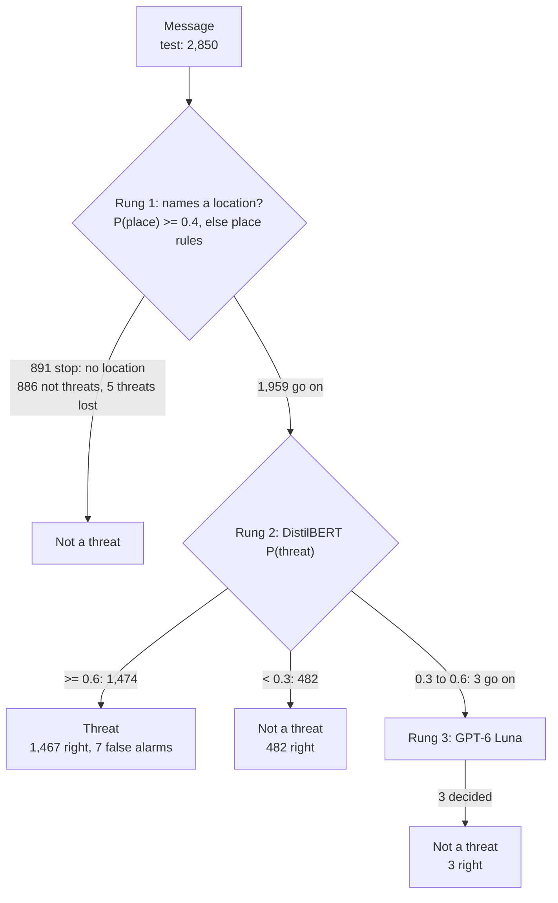

# Physical Threat Facilities: detection pipeline (development)

Decides whether a message (a post, alert or article) is a **physical threat**: a danger or disruption to people or places, tied to a real location.
A three-rung ladder: cheap models first, GPT-6 Luna only for what they cannot settle. The API is in `../../inference/PhysicalThreatFacility/`.

| Folder | Contents |
|---|---|
| `code/` | numbered scripts 01 to 04, plus the rung modules and the Luna prompt |
| `data/` | the dataset, splits and teacher labels |
| `outputs/` | the trained models, the ladder results and the shipped results (not in git) |

## Pipeline



| Rung | Model | Choice | Threshold and how it was set | Stops (test) | Time / cost per 1,000 |
|---|---|---|---|---:|---|
| 1 | MiniLMv2 word tagger, place rules as fallback | no place means not a threat; 100x faster than GLiNER with fewer misses (5 vs 12) | **0.4**, picked on val: fewest val threats lost, provided it loses no more than GLiNER (17 vs 23) and passes at most 10% more non-threats (487 vs 456) | 891 | 0.6 ms, $0.00008 |
| 2 | DistilBERT multilingual, trained 3 epochs on a balanced train set | two cut-offs, so only the middle band costs an LLM call | **>= 0.6** threat, **< 0.3** not a threat, between goes on | 1,956 | 3 ms, $0.00043 |
| 3 | GPT-6 Luna, prompt v14 | sees only the unsure band | none; it answers directly | 3 | 1.7 s, $0.297 |

Rungs 1 and 2 are costed as GPU time on a g4dn.xlarge (T4, $0.526 per hour); Luna at $0.10 per 1M input and $0.50 per 1M output tokens, no caching.

### How the numbers add up (test)

| | Messages | Threats | Not threats |
|---|---:|---:|---:|
| All messages | 2,850 | 1,472 | 1,378 |
| Rung 1 stops | 891 | 5 | 886 |
| Sent to Rung 2 | 1,959 | 1,467 | 492 |
| Rung 2: threat | 1,474 | 1,467 | 7 |
| Rung 2: not a threat | 482 | 0 | 482 |
| Rung 3 | 3 | 0 | 3 |

### Final confusion matrix (test)

| | Predicted threat | Predicted not |
|---|---:|---:|
| **Actually a threat** | 1,467 (TP) | 5 (FN) |
| **Actually not** | 7 (FP) | 1,371 (TN) |

Precision 99.53%, recall 99.66%, F1 99.59%.

- **The 5 misses** are all at Rung 1: the place is written only as a code, hashtag or adjective (`#lebanon24`, `#iawx`, Czech "belgický", "KZN", "black horse pike").
- **The 7 false alarms** are all at Rung 2: non-threats that mention a place.
- The ladder costs $0.0020 for the 2,850 messages against $0.847 if every message went to Luna (433x cheaper). Per-message results: `outputs/shipped_results/test_predictions.csv`.

## What each model receives

| Rung | Model | Input | Output |
|---|---|---|---|
| 1 | MiniLMv2 word tagger | the message with links and @handles removed and hashtags split into words (`#ChicagoScanner` becomes "Chicago Scanner"); first 3,000 characters in pieces of up to 1,000 | for each word, the probability it is part of a place; a message has a location if any word reaches 0.4 |
| 2 | DistilBERT multilingual | the raw message, up to 128 tokens | P(threat) |
| 3 | GPT-6 Luna | the prompt below | JSON: `label`, `subtype`, `confidence`, `reason` |

### Rung 3 prompt (GPT-6 Luna, v14)

The system prompt (about 9,500 characters) is fixed. Its core, in short:

```
You are a security analyst triaging content for a physical-threat monitoring service.
THE RULE: a physical threat = a THREAT + an ANCHOR. The anchor is a pinned-down location OR a named event
that identifies its place. A named person, company, organisation or government on its own is NOT an anchor.
Both parts are needed. Otherwise label 0.
  1. THREAT: violence and crime, terrorism, war, protests and rallies, explosions and bomb threats,
     fires, spills, outages, accidents, severe weather and disasters, public-safety problems ...
  2. ANCHOR: a street, city, state, country or named venue; or a named event that identifies its place.
  Not a threat: fiction, jokes and slang, software outages with no physical effect ...
SUBTYPE: if label is 0 the subtype is "none"; if 1, exactly one of 33 subtypes
  ("structure fires", "gun violence", "protest - organized", "explosions", "police activity", ... "other").
Reply with JSON only.
```

The user message is the text itself, cut to 4,000 characters:

```
TEXT:
Birleşik Devletler posta servisi ' ni dikkate alın .
```

The answer is forced into this JSON shape (`response_schema.json`), temperature 0:

```json
{"label": 0 or 1, "subtype": "<one of the 33, or none>", "confidence": <number>, "reason": "<short text>"}
```

## Data

10,000 threats (CTI API export) and 9,193 non-threats (public datasets: Civil Comments 2,266, figurative disaster tweets 2,065, GoEmotions 1,502, XNLI 1,494, AG News 1,403, synthetic cyber/fraud/outage 463). 807 non-threats that Luna flagged were removed.
Split 70 / 15 / 15 by source (seed 42); 563 train threats were set aside so that train is exactly 50/50.

| File | Rows | Use |
|---|---:|---|
| `splits/train.csv` | 12,874 | trains both models |
| `splits/val.csv` | 2,878 | picks the Rung 1 cut-off |
| `splits/test.csv` | 2,850 | final test, never used for training or tuning |
| `teacher_labels/` | 2 files | GLiNER place labels the Rung 1 model was trained on |
| `data_quality_issues.csv` | 28 | test threats that name no place in the text; removed from test |
| `dataset_clean.csv` | 19,165 | every message except those 28 |
| `luna_location_labels_test_threats.csv` | 1,500 | Luna's place labels for test threats, used to test Rung 1 |

## Run

Run from the `PhysicalThreatFacility` folder. Packages are in `requirements.txt`.

| Step | Script | What it does | Writes (in `outputs/`) |
|---|---|---|---|
| 01 | `01_make_teacher_labels.py` | GLiNER marks the places in train and val (optional; needs `pip install gliner`; shipped labels are in `data/teacher_labels/`) | `01_make_teacher_labels/` |
| 02 | `02_train_location_model.py` | trains Rung 1 (8 epochs, AdamW, lr 5e-5) and picks the cut-off on val | `02_train_location_model/` |
| 03 | `03_train_threat_model.py` | trains Rung 2 (about 3 minutes on a T4) | `03_train_threat_model/` |
| 04 | `04_run_ladder.py` | runs the ladder on a CSV with a `text` column | `04_run_ladder/` |

```bash
python code/04_run_ladder.py data/splits/test.csv --no-gpt     # Rungs 1-2, free
python code/04_run_ladder.py data/splits/test.csv              # all rungs (about $0.001)
python code/04_run_ladder.py --text "Shots fired near 5th Ave and Pine St, Seattle"
```

Luna needs `OPENAI_API_KEY` in the environment or a `.env` file (or the file named by `OPENAI_ENV_FILE`).
The shipped models are in `outputs/02_train_location_model/model` and `outputs/03_train_threat_model/model`, and are copied to `../../inference/PhysicalThreatFacility/model/`.
