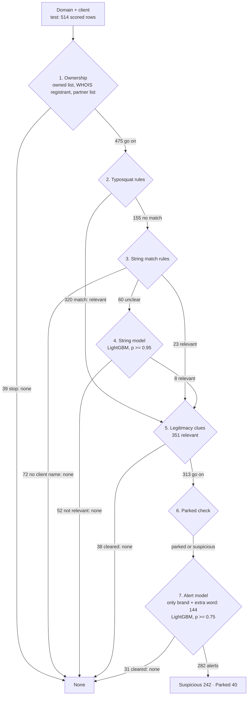

# Suspicious-domain detection (development)

Given a domain and the client it might target, decide: **suspicious domain registration**, **domain parked**, or **none**.
Everything is rules and two small LightGBM models; no LLM. The API is in `../../inference/SuspiciousDomain/`.

| Folder | Contents |
|---|---|
| `code/` | numbered scripts 01 to 03, plus one file per detector step |
| `data/` | the synthetic benchmark: `domains.json`, `customers.json`, `intake.json`, `intake_truth.json`, `tranco.json`, and the planning documents (`docs/`) (not in git) |
| `outputs/` | what the scripts write, and `shipped_results/` (not in git) |

## Pipeline

Counts are the benchmark **test split**: 514 scored rows from 2 clients the models never saw (241 suspicious, 40 parked, 233 not relevant).



| Step | File | What it does | Threshold | Stops (test) |
|---|---|---|---|---:|
| 1. Ownership | `ownership.py` | the domain is on the client's owned list, the WHOIS registrant is the client, or it is a listed partner, reseller or franchisee | lists only | 39 |
| 2. Typosquat rules | `typosquat.py` | lookalike characters, other ending, country-code abuse, plural, missing dot, misspelling, brand + extra word | edit limit by name length: 2 for up to 9 letters, 3 above | 320 flagged |
| 3. String match | `string_match.py` | finds brand parts, products and executive names; an executive's full name, or a brand next to a word like "login", is relevant; a name only inside a longer real word is clear | rules | 72 stop, 23 flagged |
| 4. String model | `string_model.py` | LightGBM on the names the rules call unclear | **p >= 0.95**, picked on val for the best F1 | 52 stop, 8 flagged |
| 5. Legitimacy | `legitimacy.py` | a named owner other than the client with a Tranco rank, or its own business name and a contact page; real typos are never cleared | rules | 38 |
| 6. Parked check | `parked.py` | a parking nameserver or a parking page gives "parked", otherwise "suspicious" | list of parking services | labels 313 |
| 7. Alert model | `alert_model.py` | LightGBM on the "brand + extra word" alerts, which gave 129 of the 130 false alarms on train and val | **p >= 0.75**, picked on val | 31 cleared of 144 |

Both models are trained on the train clients only (string model: 206 rows, 33 relevant; alert model: 398 alerts, 97 harmless) and their thresholds are picked on the val clients. Test is read only by `03_evaluate.py --test`.

### How much each step filters

| Split | Scored rows | 1 stops | 2 flags | 3 stops / flags | 4 stops / flags | 5 stops | 7 clears | Alerts |
|---|---:|---:|---:|---:|---:|---:|---:|---:|
| Train (6 clients) | 1,595 | 124 | 935 | 251 / 79 | 173 / 33 | 104 | 97 of 398 | 846 |
| Val (2 clients) | 543 | 42 | 310 | 60 / 29 | 89 / 13 | 38 | 31 of 135 | 283 |
| **Test (2 clients)** | **514** | **39** | **320** | **72 / 23** | **52 / 8** | **38** | **31 of 144** | **282** |

"Stops" are rows answered "none"; "flags" are rows called relevant. Rows left out of scoring: 181 questionable rows and 90 web-clone rows (case P15), which belong to the web-clone detector.

### Final confusion matrices

| Truth \ predicted | Train: susp. | Train: parked | Train: none | Val: susp. | Val: parked | Val: none | **Test: susp.** | **Test: parked** | **Test: none** |
|---|---:|---:|---:|---:|---:|---:|---:|---:|---:|
| **Suspicious** | 725 | 0 | 0 | 242 | 0 | 0 | **239** | **0** | **2** |
| **Parked** | 0 | 120 | 0 | 0 | 40 | 0 | **0** | **40** | **0** |
| **None** | 1 | 0 | 749 | 1 | 0 | 260 | **3** | **0** | **230** |

Test: accuracy 99.0%; alert (either incident type) precision 98.9%, recall 99.3%, F1 99.1%. All 5 test errors come from Step 7: 3 false alarms (two fan or review sites and a brand inside another word) and 2 missed suspicious domains cleared by the alert model.
The data is generated, so read this as a test of the pipeline, not of real-world accuracy.

## What each model receives

Both models are LightGBM and read the **same 28 numbers**, built from the domain name, the client's profile and the stored facts of the domain. A worked example: `apexclimbinggym.com` for Apex Mutual (an insurer; names `apex`, `apexmutual`; products `ApexShield`, `DriveSure`, `HomeGuard Plus`). The rules cannot settle it ("brand part `apex`; no rule decides"), so the string model scores it: p = 0.00, below 0.95, so it is not relevant.

| Group | Feature | Meaning | `apexclimbinggym.com` |
|---|---|---|---:|
| Client name found | `kind_brand_part`, `kind_product`, `kind_exec_surname` | which kind of client name sits in the domain as whole words | 1, 0, 0 |
| | `surname_and_brand` | an executive's surname and a brand name together | 0 |
| | `term_common` | how common the matched name is as a word (higher is more common) | 3.71 |
| | `term_is_word` | the name is an ordinary word (`apex`) | 1 |
| | `term_len` | length of the matched name | 4 |
| | `coverage` | share of the domain the client names cover | 0.27 |
| | `n_names` | different client names found | 1 |
| The other words | `n_other` | words left over (`climbing`, `gym`) | 2 |
| | `n_sector` | words from the client's industry (insurance, claim, policy ...) | 0 |
| | `n_other_business` | words of another business (gym, dental, bakery ...) | 1 |
| | `n_selling` | selling words (deals, rewards, shop ...) | 0 |
| | `other_common` | average commonness of those words | 4.28 |
| | `n_second_lang` | words in the client's second language | 0 |
| Domain shape | `length`, `hyphens` | letters in the name, hyphens | 15, 0 |
| | `tld_com`, `tld_client` | ends in `.com`; ends in a country ending the client owns | 1, 0 |
| Domain facts | `owner_hidden` | WHOIS owner hidden or empty | 0 |
| | `parked` | parking nameserver or parking page | 0 |
| | `live` | a page answers | 1 |
| | `login_form` | the page has a password box | 0 |
| | `own_business_name`, `contact_page`, `privacy_page` | the page shows its own business name, a contact page, a privacy page | 1, 1, 1 |
| | `links_to_client`, `client_logo` | the page links to the client's site, shows the client's logo | 0, 0 |

Domain age is left out on purpose: in the generated data every squatter is young, so the model would learn "young means threat", which means nothing in a feed of newly registered domains.

What goes into the 28 numbers:

| Input | Where it comes from |
|---|---|
| the domain | the request |
| the client's names | `brand_terms`, `products`, `executives` (RDS) |
| the client's industry and languages | `customers` (RDS) |
| the client's own endings | `customer_domains` (RDS) |
| WHOIS owner, nameservers, HTTP and page facts | `domain_lookups` (RDS) |

The **string model** (Step 4) scores the names the rules call unclear and passes them at p >= 0.95. The **alert model** (Step 7) scores the "brand + extra word" alerts with the same 28 numbers and keeps them at p >= 0.75. No LLM is used.

## Run

Run from the `SuspiciousDomain` folder. Needs `lightgbm`, `wordfreq`, `wordsegment`, `tldextract`.

| Step | Script | What it does | Writes (in `outputs/`) |
|---|---|---|---|
| 01 | `01_build_intake.py` | builds the day's intake from `data/domains.json` (what the data sources know about each domain, no labels; add `--noise N` for unrelated registrations) | `data/intake.json`, `data/intake_truth.json` |
| 02 | `02_train_and_run.py` | trains the string model and the alert model, runs every step on every row, writes the predictions | `02_train_and_run/predictions.jsonl`, `model/` (`string_model.txt`, `alert_model.txt`, `thresholds.json`) |
| 03 | `03_evaluate.py` | scores the predictions (`--test` adds the test split); `02` runs it for train and val | `02_train_and_run/eval.json` |

```bash
python code/02_train_and_run.py --test        # about 10 seconds
```

The two model files are copied to `../../inference/SuspiciousDomain/model/`. `data_api.py` stands in for the live sources (WHOIS, DNS, HTTP, a browser, the Tranco list) by reading `data/intake.json`; the service reads the same facts from RDS.

## Where the data lives

- **Local:** `data/` and `outputs/`.
- **S3** `drp-pipeline/suspicious-domains/`: `domains/0001.txt` to `2923.txt` (one domain per file) and `metadata/` (`domains.json`, `files.csv`, `intake_truth.json`).
- **RDS** `drp_clients`: `domain_lookups` (the facts of each domain), `domain_ownership`, `tranco_ranks`, and the client tables (`customers`, `customer_domains`, `brand_terms`, `products`, `executives`, `third_parties`). See `../../DataSchema.md`.
