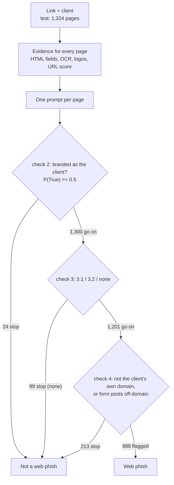

# Web-phish detection (development)

Given a link and the client it might imitate, decide whether the page is a **web phish**: it presents itself as the client (check 2), it asks for credentials or payment data or has a login link (check 3), and it is not on the client's own domain (check 4).
The API is in `../../inference/WebPhish/`.

| Folder | Contents |
|---|---|
| `code/` | numbered scripts in run order, plus helpers |
| `data/` | `benchmark/items.csv` (index of every item), saved pages and screenshots, client assets, Phishpedia weights |
| `outputs/` | everything the scripts write, one folder per step (not in git) |

## Pipeline



| Step | What it does | Threshold | Stops (test) |
|---|---|---|---:|
| Evidence | HTML fields (lxml), OCR text (docTR), logo similarity (Phishpedia), suspicious-URL score (LightGBM) | none; used as input, not as filters | 0 |
| check 2 | mmBERT: does the page present itself as the client? Trained on real pages plus made-up client-page pairs (a page paired with the wrong client) | P(True) **>= 0.5** | 24 |
| check 3 | mmBERT: 3.1 box for credentials or payment data; 3.2 login link or button; none | highest of three probabilities; "none" stops | 99 |
| check 4 | is the page on the client's own domain (allowlist, user-content hosts, owned TLDs)? | rule; an own-domain page passes only if its form posts to another domain | 213 |

Verdict: `branded` and `case is not none` and (`not on the client's own domain` or `form posts off-domain`). Both models: mmBERT-base, 8,192 tokens, fp16, **9 epochs**, epoch 9 shipped.

### How much each step filters

| Split | Pages | check 2 stops | check 3 stops | check 4 stops | Flagged |
|---|---:|---:|---:|---:|---:|
| Train | 3,971 | 60 | 269 | 683 | 2,959 |
| Val | 1,324 | 27 | 110 | 211 | 976 |
| **Test** | **1,324** | **24** | **99** | **213** | **988** |

Real web phishes wrongly stopped (check 2 / check 3 / check 4): train 0 / 0 / 0, val 1 / 5 / 0, test 5 / 2 / 0.

### Final confusion matrices

| | Train: pred. phish | Train: pred. not | Val: pred. phish | Val: pred. not | **Test: pred. phish** | **Test: pred. not** |
|---|---:|---:|---:|---:|---:|---:|
| **Actually web phish** | 2,957 | 0 | 964 | 6 | **980** | **7** |
| **Actually not** | 2 | 1,012 | 12 | 342 | **8** | **329** |

Test: precision 99.19%, recall 99.29%. Val: precision 98.77%, recall 99.38%. Ground truth is `routed_to == "Web Phish"` in `labels.csv`.

Each model alone on test:

| Model | Rows | Accuracy |
|---|---:|---:|
| check 2, real pages | 1,324 | 99.32% |
| check 2, made-up pairs | 1,301 | 99.85% |
| check 3, real pages | 1,324 | 97.28% |

## What each model receives

### Check 2 and check 3 (fine-tuned mmBERT): one text prompt per page

Both models read the same prompt, built from the stored HTML, the screenshot and two scores. A real example (`pos/facebook/0520`, a fake Facebook login):

```
[CLIENT] Facebook
[TITLE] Facebook application
[HEADINGS] wefwfwefwf
[BRAND_HINTS]
[FORMS] action='../../login.php' method=post | input type=text name='email' placeholder='Email or phone' | input type=password name='pass' placeholder='Password'
[SCRIPT_URLS]
[LINKS] button: Log In ->
[VISIBLE_TEXT] wefwfwefwf wefwfwefwf Log In Facebook needs to confirm the following information to allow access to this application videos, Login!
[OCR_TEXT] Email or phone | Password | Login | AFacebook needs to confirm the following information to allow access to this application videos, Login!
[SIGNALS] logo_similarity=unknown p_suspicious_url=0.91
```

| Field | Where it comes from |
|---|---|
| `CLIENT` | the client's display name |
| `TITLE`, `HEADINGS` | the page's title and headings |
| `BRAND_HINTS` | brand clues in the HTML, such as the favicon file name |
| `FORMS` | each form's action and method, and every input (type, name, placeholder) |
| `SCRIPT_URLS` | URLs and redirects found in scripts |
| `LINKS` | link and button texts with their targets |
| `VISIBLE_TEXT` | the text a visitor sees in the HTML |
| `OCR_TEXT` | the text read from the screenshot (docTR), lines joined with `|` |
| `SIGNALS` | `logo_similarity` (best match of a logo on the page to the client's logos, 0 to 1, `unknown` if none) and `p_suspicious_url` (the URL model below; `forwarded` for link shorteners) |

The prompt is limited to 8,192 tokens; if longer, fields are shortened in a fixed order. Check 2 answers `False` / `True`; check 3 answers `3.1` / `3.2` / `none`.

### URL model (LightGBM): 25 numbers from the link's host name only

Its score goes into `SIGNALS`. Example: `http://infosantioana.hi2.ro/php/update/` (only the host `infosantioana.hi2.ro` is used).

| Feature | Meaning | Example |
|---|---|---:|
| `host_len` | characters in the host | 20 |
| `domain_len` | length of the name just left of the ending (`hi2`) | 3 |
| `host_dots` | dots in the host | 2 |
| `subdomain_levels` | labels left of the registered domain | 1 |
| `host_hyphens` | hyphens in the host | 0 |
| `host_digits` | digits in the host | 1 |
| `is_ip` | host is an IP address | 0 |
| `has_port` | link names a port | 0 |
| `punycode` | host has `xn--` (look-alike letters) | 0 |
| `mixed_scripts` | letters from more than one alphabet | 0 |
| `host_entropy` | randomness of the host's letters | 3.27 |
| `tld_len` | length of the ending (`ro`) | 2 |
| `consonant_ratio` | share of consonants | 0.47 |
| `longest_consonant_run` | longest run of consonants | 2 |
| `shared_host` | on a free hosting platform (github.io, weebly.com, ...) | 0 |
| `brand_in_host` | contains a client's brand word but is not that client's own domain | 0 |
| `tld` | the ending as a category | `ro` |
| `tld_risk` | share of phishing links with that ending in training | 0.36 |
| `host_kw_login`, `host_kw_secure`, `host_kw_verify`, `host_kw_account`, `host_kw_update`, `host_kw_support` | host contains the word | 0 |
| `host_kw_count` | how many of 22 risky words the host contains | 0 |

## Run (every script reads `data/benchmark/items.csv`)

Run from the `WebPhish` folder, for example `python code/01_parse_html.py`.

| Step | Script | Writes (in `outputs/`) |
|---|---|---|
| 01 | `01_parse_html.py` | `01_parse_html/b_html_fields.parquet` |
| 02 | `02_ocr_read_screenshots.py` | `02_ocr_read_screenshots/` |
| 03 | `03_build_logo_gallery.py` | `03_logo_similarity/logo_gallery.npz` |
| 04 | `04_detect_and_match_logos.py` | `03_logo_similarity/logo_scores.parquet` |
| 05 | `05_check_logo_boxes.py` (optional) | `03_logo_similarity/check/` |
| 06 | `06_build_prompts.py` | `06_build_prompts/check2.parquet`, `check3.parquet` |
| 07 | `07_train_models.py` | `07_train_models/check2/`, `check3/`: 9 epochs, each saved with its optimizer state |
| 08 | `08_predict.py` | next to the checkpoint |
| 09 | `09_build_error_viewer.py` | `09_build_error_viewer/` |

`setup_env.sh` builds the environment (detectron2 and the Phishpedia weights). The epoch-9 models are copied to `../../inference/WebPhish/model/`.
