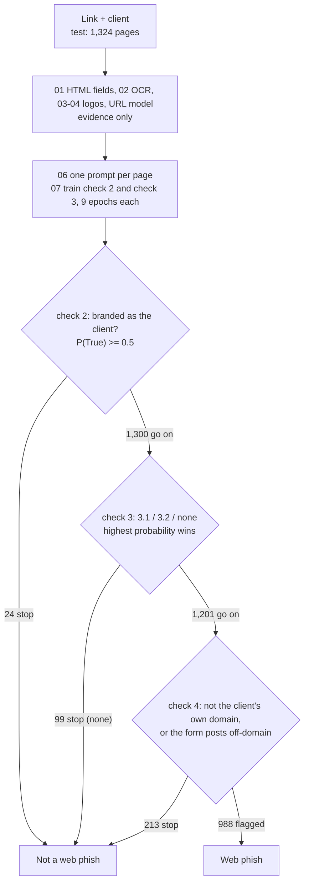

# Web-phish detection (development)

Given a link and the client it might imitate, decide whether the page is a web phish: it presents itself as the client (check 2), it asks
for credentials or payment data, or has a login link (check 3), and it is not on the client's own domain (check 4).
The API for this detector is in `../../inference/WebPhish/`.

| Folder | What it is |
|---|---|
| `code/` | Numbered scripts in run order, plus helpers |
| `data/` | The benchmark: `benchmark/items.csv` (the index of every item), the saved pages and screenshots, `customer_assets/`, `models/phishpedia/` |
| `outputs/` | Everything the scripts write, one folder per step (not in git) |

## Run order (every script reads `data/benchmark/items.csv`)

| Step | Script | Writes (in `outputs/`) |
|---|---|---|
| 01 | `01_parse_html.py` | `01_parse_html/b_html_fields.parquet` |
| 02 | `02_ocr_read_screenshots.py` | `02_ocr_read_screenshots/` (one JSON per item) |
| 03 | `03_build_logo_gallery.py` | `03_logo_similarity/logo_gallery.npz` |
| 04 | `04_detect_and_match_logos.py` | `03_logo_similarity/logo_scores.parquet` and more |
| 05 | `05_check_logo_boxes.py` (optional) | `03_logo_similarity/check/` |
| 06 | `06_build_prompts.py` | `06_build_prompts/check2.parquet`, `check3.parquet` |
| 07 | `07_train_models.py` | `07_train_models/check2/`, `check3/`: 9 epochs each, every epoch saved with its optimizer state |
| 08 | `08_predict.py` | next to the checkpoint |
| 09 | `09_build_error_viewer.py` | `09_build_error_viewer/` |

Helpers: `logo_common.py`, `phishpedia_bit.py`, `model_common.py`, `error_viewer.html`, `setup_env.sh` (builds `.venv` with detectron2 and fetches the Phishpedia weights).
Run from the `WebPhish` folder, for example `python code/01_parse_html.py`.

## The pipeline step by step: choices, thresholds and counts

Every script reads `data/benchmark/items.csv`. Steps 01 to 06 collect evidence for **every** page and filter nothing; the three checks in step 08 are the filters. Counts are the **test split** (1,324 pages, 987 web phishes), from the epoch-9 models.

### What each step does and why it is set that way

| Step | What it does | The choice we made | Threshold |
|---|---|---|---|
| 01 HTML | Parses the saved page (lxml): title, headings, forms, script URLs, links, visible text | Text fields come from the saved HTML of the capture | none |
| 02 OCR | docTR (`db_resnet50` + `parseq`) reads the screenshot text | Adds the text that is only visible in the screenshot | none |
| 03-04 Logos | Phishpedia: a Faster R-CNN finds logos, a BiT siamese model matches them to the client's logos | Gives a "logo similarity" evidence line, not a verdict | none |
| URL model | LightGBM `host_only`, 25 features of the link's host (including a brand-in-host feature built from all clients' brand words and owned domains) | Used as evidence in the prompt, not as a filter | none |
| 06 Prompt | One text: CLIENT, TITLE, HEADINGS, BRAND_HINTS, FORMS, SCRIPT_URLS, LINKS, VISIBLE_TEXT, OCR_TEXT, SIGNALS. Too long: fields are shortened in a fixed order | Same prompt for both models; max 8,192 tokens | none |
| 07 Train | Fine-tunes mmBERT-base twice: check 2 (False / True) and check 3 (3.1 / 3.2 / none), **9 epochs each**, fp16, every epoch saved with its optimizer state | We ship epoch 9 of both | none |
| check 2 | Does the page present itself as the client? Trained on real pages plus made-up client-page pairs (a page paired with the wrong client) so it learns to compare, not just to spot a brand | The first filter: unbranded pages stop here | **P(True) >= 0.5** |
| check 3 | 3.1 = a box for credentials or payment details; 3.2 = a login link or button; none = neither | A page that gives the visitor no way to hand over data is not a phish | **highest of three probabilities**; "none" stops |
| check 4 | Is the page on the client's own domain (the allowlist, user-content hosts and owned TLDs from RDS)? | An own-domain page is not a phish, unless its form posts to another domain | rule, no number |

The final verdict is: `branded` and `case is not none` and (`not on the client's own domain` or `form posts off-domain`). Parked pages and "is it live" (check 1) are not part of the service.

### How much each step filters, per split

| Split | Pages | check 2 stops | check 3 stops | check 4 stops | Flagged |
|---|---:|---:|---:|---:|---:|
| Train | 3,971 | 60 | 269 | 683 | 2,959 |
| Val | 1,324 | 27 | 110 | 211 | 976 |
| **Test** | **1,324** | **24** | **99** | **213** | **988** |

Of the pages each step stopped, the real web phishes (wrongly stopped): train 0 / 0 / 0, val 1 / 5 / 0, test 5 / 2 / 0.
The models were trained on train, so train is close to perfect by design; val and test show how it generalises. The split is by family of pages (no family appears in two splits), and every client appears in all three splits.

### Final confusion matrices (real pages, the whole pipeline)

| | Train: pred. phish | Train: pred. not | Val: pred. phish | Val: pred. not | **Test: pred. phish** | **Test: pred. not** |
|---|---:|---:|---:|---:|---:|---:|
| **Actually web phish** | 2,957 | 0 | 964 | 6 | **980** | **7** |
| **Actually not** | 2 | 1,012 | 12 | 342 | **8** | **329** |

Test: precision 99.19%, recall 99.29%. Val: precision 98.77%, recall 99.38%.

### The two models on their own (test, epoch 9)

| Model | Rows | Accuracy | Confusion (rows = actual) |
|---|---:|---:|---|
| check 2, real pages | 1,324 | 99.32% | not branded 19 right / 4 wrong; branded 5 wrong / 1,296 right |
| check 2, made-up pairs | 1,301 | 99.85% | 1,299 right, 2 wrong |
| check 3, real pages | 1,324 | 97.28% | 3.1: 936 / 2 / 1; 3.2: 0 / 246 / 8; none: 2 / 23 / 106 (columns 3.1, 3.2, none) |

Everything is read from `outputs/05_finetune/` (`check*/epoch_9/`) and `data/benchmark/labels.csv`; the web-phish label is `routed_to == "Web Phish"`.

## Notes
- The `outputs/` folder here holds folders from the earlier Approach B runs (`01_html_parse`, `02_ocr`, `04_prompt_format`, `05_finetune`, ...). The new scripts write to the
  names in the table above, so they do not reuse those.
- The final models (epoch 9 of check 2 and check 3) were copied into `../../inference/WebPhish/model/`.
