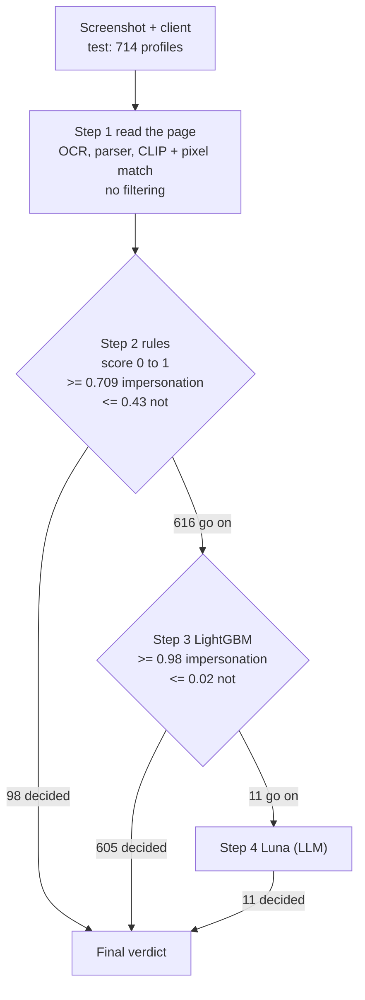

# Impersonation detection

Given a screenshot of a social-media profile and the client it might be impersonating, decide: **impersonation** or **not impersonation**.
The benchmark is synthetic: 25 real brands, 4,470 profile screenshots across six platforms (X, Facebook, Instagram, LinkedIn, Telegram, TikTok).

## What is in this folder

| Folder | What it is |
|---|---|
| `code/` | The batch pipeline: numbered scripts 01 to 10 that build, freeze and test the detector, plus `utilities/` |
| `data/` | The benchmark data: screenshots, train/val/test lists, client assets (not in git, copies are in S3) |
| `outputs/` | Everything the scripts write: intermediate results, the frozen model, reports (created on first run, not in git) |

The HTTP API for this detector is not here: it is in `../../inference/impersonation/` (served together with the web-phish detector).

## How it decides (a cascade)

1. **Read the screenshot.** OCR finds the text, a layout parser turns it into fields (name, handle, bio, link, stats, posts), and the profile picture is compared with the client's logo and executive photos (CLIP and pixel matching). About 100 numbers come out.
2. **Rules.** Hand-written points (brand in the name, logo match, "official" wording, scam wording, verified badge, ...) are added up and scaled to 0 to 1. A clear score decides (about 14% of pages).
3. **LightGBM.** A small model on the same numbers decides when it is very sure, at 2% or less or at 98% or more (about 82% of pages).
4. **Luna** (an LLM, through the OpenAI Decisions API) answers the few pages left unsure (about 4%).

The rule and model thresholds are fitted on train only. The pipeline is frozen with checksums before it is run on test.

## The pipeline step by step: choices, thresholds and counts



### What each step does and why it is set that way

| Step | What it does | The choice we made | Threshold and how it was set |
|---|---|---|---|
| 1. Read | OCR (docTR) finds the text, a layout parser fills name, handle, bio, link, stats and posts; the profile picture is matched to the client's logo and executive photos (CLIP and pixel NCC over 5 crops). About 100 numbers per page, 79 of them signals. | Use the screenshot only, no HTML and no platform data | Nothing is filtered here |
| 2. Rules | 21 hand-written rules add points (brand in the name, logo match, "official" wording, scam wording, verified badge, ...); the sum is rescaled to 0 to 1 with fixed limits (-18.5 and 21.0) | Rules answer only when the score is clear | **0.709** and **0.43**. Searched on **train only**, in steps of 0.001: the lowest score above which 99.5% of pages are impersonations, and the highest below which 99.5% are not (each must cover at least 20 train pages) |
| 3. LightGBM | A small model on the same 102 numbers, trained on train | It answers only when very sure; train predictions are out-of-fold so the train funnel is honest | **0.98** and **0.02** (the model's own probability) |
| 4. Luna | GPT-6 Luna through the OpenAI Decisions API (never a local model) reads the page evidence | Called only for the pages left unsure, so the LLM cost stays small | No threshold; it answers impersonation or not |

The thresholds and the model are fitted on train and then **frozen with checksums** (step 08, the test run, stops if a code file changed since step 05); test is read only after that.

### How much each step filters, per split

| Split | Pages | Rules decide | Sent to LightGBM | LightGBM decides | Sent to Luna (Luna decides) |
|---|---:|---:|---:|---:|---:|
| Train (17 clients) | 3,036 | 430 (14.2%) | 2,606 | 2,490 (82.0%) | 116 (3.8%) |
| Val (4 clients) | 720 | 100 (13.9%) | 620 | 593 (82.4%) | 27 (3.8%) |
| **Test (4 clients)** | **714** | **98 (13.7%)** | **616** | **605 (84.7%)** | **11 (1.5%)** |

Who was right at each step (positives / negatives decided, and wrong answers):

| Split | Rules | LightGBM | Luna |
|---|---|---|---|
| Train | 292 / 138, 0 wrong | 863 / 1,627, 1 wrong (a missed impersonation) | 69 / 47, 3 wrong (false alarms) |
| Val | 72 / 28, 0 wrong | 194 / 399, 0 wrong | 22 / 5, 0 wrong |
| Test | 63 / 35, 0 wrong | 223 / 382, 0 wrong | 2 / 9, 0 wrong |

### Final confusion matrices

| | Train: pred. imp. | Train: pred. not | Val: pred. imp. | Val: pred. not | **Test: pred. imp.** | **Test: pred. not** |
|---|---:|---:|---:|---:|---:|---:|
| **Actually impersonation** | 1,223 | 1 | 288 | 0 | **288** | **0** |
| **Actually not** | 3 | 1,809 | 0 | 432 | **0** | **426** |

Test: precision 100%, recall 100%, accuracy 714 of 714. Train: 4 errors (99.87%). The test numbers come from `outputs/reports/test_predictions.csv`; the train and val ones from `outputs/work/` (`07_final_metrics_train_val.py`).
Read the 100% with care: the data is generated, and the parser is calibrated to the way these screenshots are rendered.

## Results (synthetic benchmark)

| Split | Pages | Accuracy |
|---|---|---|
| Train (17 customers) | 3,036 | 99.87% (4 errors) |
| Val (4 customers) | 720 | 100% |
| Test (4 customers) | 714 | 100% (714 of 714) |

Splits are by customer, so no customer appears in two splits. Test has been scored several times on the same frozen pipeline and nothing was tuned on it.
Read the 100% with care: the data is generated (templated wording, AI-generated executive faces, fictional executives), and the parser is calibrated to the way these screenshots are rendered. Check on real screenshots before relying on it.

## Where the data lives

- **Local:** `data/` and `outputs/` (large, not in git).
- **S3** (`drp-pipeline/impersonation/`): the 4,470 screenshots and the metadata (`train.csv`, `val.csv`, `test.csv`, `classes.json`).
- **RDS** (schema `drp_clients`): the client profiles, logos, executive photos and their stored CLIP vectors, and the `content` table that gives every screenshot a number, its client and its split. The inference service (`../../inference/impersonation/`) reads clients from here.

## Quick start

```bash
cd code
python 01_ocr_read_screenshots.py train val test      # then 02, 04, 05, 06 ... see code/README.md
```
The API is started from the shared `inference/` folder (see `../../inference/README.md`).

Each folder has its own README.
