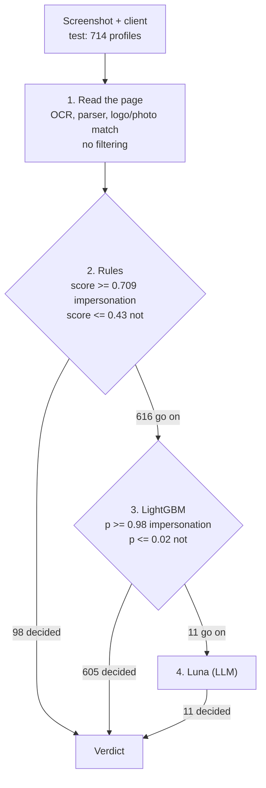

# Impersonation detection (development)

Given a screenshot of a social-media profile and the client it might impersonate, decide: **impersonation** or **not impersonation**.
Data: a synthetic benchmark of 25 real brands and 4,470 profile screenshots (X, Facebook, Instagram, LinkedIn, Telegram, TikTok).
The API is in `../../inference/impersonation/`.

| Folder | Contents |
|---|---|
| `code/` | numbered scripts 01 to 10, plus `utilities/` |
| `data/` | screenshots, train/val/test lists, client assets (not in git; copies in S3) |
| `outputs/` | everything the scripts write: intermediate results, the frozen model, reports (not in git) |

## Pipeline



| Step | What it does | Threshold and how it was set | Decides (test) |
|---|---|---|---:|
| 1. Read | OCR (docTR), layout parser, profile picture matched to the client's logo and executive photos (CLIP + pixel correlation) | none, nothing is filtered | 0 of 714 |
| 2. Rules | 21 hand-written rules add points; the sum is rescaled to 0 to 1 (fixed limits -18.5 and 21.0) | impersonation at **>= 0.709**, not at **<= 0.43**. Searched on train only: the score beyond which 99.5% of pages are right (at least 20 train pages) | 98 |
| 3. LightGBM | small model on the same 102 numbers; train predictions are out-of-fold | impersonation at **>= 0.98**, not at **<= 0.02** | 605 |
| 4. Luna | GPT-6 Luna (OpenAI Decisions API) reads the screenshot and a fact sheet | none; it answers directly | 11 |

Thresholds and model are fitted on train, then frozen with checksums before the test run.

### How much each step filters

| Split | Pages | Rules decide | Sent to LightGBM | LightGBM decides | Sent to Luna |
|---|---:|---:|---:|---:|---:|
| Train (17 clients) | 3,036 | 430 (14.2%) | 2,606 | 2,490 (82.0%) | 116 (3.8%) |
| Val (4 clients) | 720 | 100 (13.9%) | 620 | 593 (82.4%) | 27 (3.8%) |
| **Test (4 clients)** | **714** | **98 (13.7%)** | **616** | **605 (84.7%)** | **11 (1.5%)** |

Wrong answers per step: train 0 (rules), 1 (LightGBM), 3 (Luna); val and test 0 everywhere.

### Final confusion matrices

| | Train: pred. impersonation | Train: pred. not | Val: pred. impersonation | Val: pred. not | **Test: pred. impersonation** | **Test: pred. not** |
|---|---:|---:|---:|---:|---:|---:|
| **Actually impersonation** | 1,223 | 1 | 288 | 0 | **288** | **0** |
| **Actually not** | 3 | 1,809 | 0 | 432 | **0** | **426** |

Test accuracy 714 of 714; train 99.87%. Splits are by client, so test clients are never seen in training. The data is generated, so the 100% tests the pipeline, not real-world accuracy.

## What each model receives

### Rules and LightGBM: one row of 102 numbers per profile

The screenshot is turned into numbers; nothing else (no HTML, no platform data) is used. A sample row (`imp_p1_apple_0`, a fake "Apple Support" account):

| Name | Handle | Bio | Link | Followers | Logo match | Rule score | LightGBM p | Answer |
|---|---|---|---|---:|---|---:|---:|---|
| Apple Support | applex | Customer service for Apple. Response within mi... | none | 450 | strong | 0.709 | 0.9994 | impersonation |

The 102 features (the rules use the same numbers; LightGBM also gets each rule's points):

| Group | Feature | Meaning |
|---|---|---|
| Name and handle vs brand | `name_brand`, `handle_brand` | fuzzy match (0 to 100) of the display name / handle to the brand; "Acme Support" still matches "Acme" |
| | `name_has_brand`, `handle_has_brand` | 1 if the brand's letters appear inside the name / handle |
| | `name_ratio`, `handle_ratio` | whole-string similarity (0 to 100) to the brand |
| | `name_equals_brand`, `handle_equals_brand` | 1 if identical to the brand |
| Handle shape | `handle_claim` | 1 if it ends like "official", "support", "help", "hq", "billing" |
| | `handle_digits`, `handle_len`, `handle_us` | digit count, length, count of `_` and `.` |
| | `handle_extra` | characters beyond the brand name (-1 if the brand is not in the handle) |
| Bio and posts | `bio_brand`, `post_brand` | brand named in the bio / number of posts naming it |
| | `bio_len`, `no_bio` | bio length, 1 if empty |
| | `n_posts_seen`, `no_posts` | posts visible, 1 if none |
| | `post_name_match` | share of posts written under the profile's own name (-1 if no posts) |
| Banner | `banner_text`, `banner_brand` | banner text present / matches the brand |
| Links | `link_official`, `link_other`, `link_none` | an official-domain link, another domain, or no link |
| | `link_lookalike`, `link_sim` | another domain that contains the brand or is 70%+ like the official domain; the highest such similarity |
| | `link_brand_sub` | the brand sits inside another domain |
| | `link_bio_only` | link appears in the bio but not the link field |
| | `link_field_official`, `link_field_other` | the link field is the official domain / another domain |
| Word lists (22) | `h_*` (name + bio) and `p_*` (posts) for `claim`, `disc`, `own`, `scam`, `hire`, `dm`, `partner`, `role`, `personal`, `employee`, `promo` | how many words of each list appear. `claim` = official, support, care; `disc` = fan, parody, unofficial; `own` = "my own opinions"; `scam` = giveaway, crypto, refund; `hire` = careers; `dm` = DM us, WhatsApp; `partner` = reseller, agency; `role` = CEO, director; `personal` = hobbies, family; `employee` = works at; `promo` = discount |
| | `disc_any`, `scam_any` | 1 if a disclaimer / scam word appears anywhere |
| Executives | `exec_name`, `exec_name_exact` | best similarity of the name to a protected executive; 1 if 92+ |
| | `exec_role_bio`, `exec_role_any`, `exec_brand_bio` | bio holds that executive's role / any executive title / the brand name |
| Profile picture | `av_logo_clip`, `av_logo_ncc` | match to the client logo (CLIP and pixel correlation) |
| | `av_exec_clip`, `av_exec_ncc` | match to the executive photos |
| | `av_sil_clip`, `av_sil_ncc` | match to the generic default silhouette |
| | `av_av_sat`, `av_av_std`, `av_av_mean` | colourfulness, contrast, brightness of the picture |
| | `av_logo_strong`, `av_exec_strong`, `av_default` | 1 if the logo (ncc > 0.5 or clip > 0.9), executive photo (ncc > 0.70 or clip > 0.80) or silhouette (ncc > 0.7) matches |
| Account | `followers`, `following`, `posts_n` | counts shown (-1 if not shown; LinkedIn connections count as followers) |
| | `age_months`, `log_followers`, `foll_ratio` | account age, log of followers, followers per following |
| | `verified` | 1 if a verified badge is found in the header |
| Rule points (21) | `r_name_brand` +2, `r_typo_name` +1.5, `r_handle` +1, `r_logo` +2.5, `r_logo_weak` +1, `r_claim` +1.5, `r_link_look` +2, `r_banner` +1, `r_dm` +0.5, `r_exec_name` +2, `r_exec_photo` +2.5, `r_exec_bio` +1.5 | points toward impersonation (the value shown is the maximum) |
| | `n_scam` -4, `n_verified` -4, `n_disc` -2.5, `n_own` -2, `n_partner` -1.5, `n_link_official` -1.5, `n_personal` -1, `n_egg` -1.5, `n_young_nothing` -0.5 | points against (scam pages are another incident type) |
| Totals | `rule_score` | all points added, rescaled to 0 to 1 |
| | `plat_code` | platform as a number (X 0, Facebook 1, Instagram 2, LinkedIn 3, Telegram 4, TikTok 5) |

### Luna: the screenshot and a short fact sheet

Luna sees only the pages the first two stages left unsure. Instructions (summary): decide whether the account pretends to *be* the client or one of its protected executives; fan, parody, partner, namesake, personal and scam accounts are not impersonation. Input for the sample above:

```
## 1. Client
{"name": "Apple", "official_domain": "apple.com", "protected_executives": [{"name": "...", "role": "..."}, ...]}

## 3. Automated checks
{"avatar_matches_client_logo": true, "avatar_matches_protected_executive_photo": false,
 "verified_badge_detected": false, "link_on_page": "none"}

[client's official logo image]   [screenshot of the profile image]
```
Answer: one choice, `impersonation` or `not_impersonation`, with its probability.

## Run

```bash
cd code
python 01_ocr_read_screenshots.py train val test
```

| Script | Does |
|---|---|
| `01_ocr_read_screenshots.py` | OCR of every screenshot |
| `02_avatar_matching.py` | profile picture against client logo and executive photos |
| `03_check_parser_accuracy.py` | checks the layout parser |
| `04_build_signals.py` | builds the signals |
| `05_fit_cascade_train_val.py` | fits the rule thresholds and LightGBM on train, runs train and val, freezes |
| `06_luna_unsure_pages.py` | Luna on the unsure train and val pages |
| `07_final_metrics_train_val.py` | final train and val confusion matrices |
| `08_run_test.py` | runs the frozen pipeline on test (stops if a frozen file changed) |
| `09_measure_runtime.py` | timing per stage |
| `10_build_report.py` | the HTML report |

## Where the data lives

- **Local:** `data/` and `outputs/`.
- **S3** `drp-pipeline/impersonation/`: the 4,470 screenshots and `train.csv`, `val.csv`, `test.csv`, `classes.json`.
- **RDS** `drp_clients`: client profiles, logos, executive photos and their CLIP vectors; the `content` table numbers every screenshot. See `../../DataSchema.md`.
