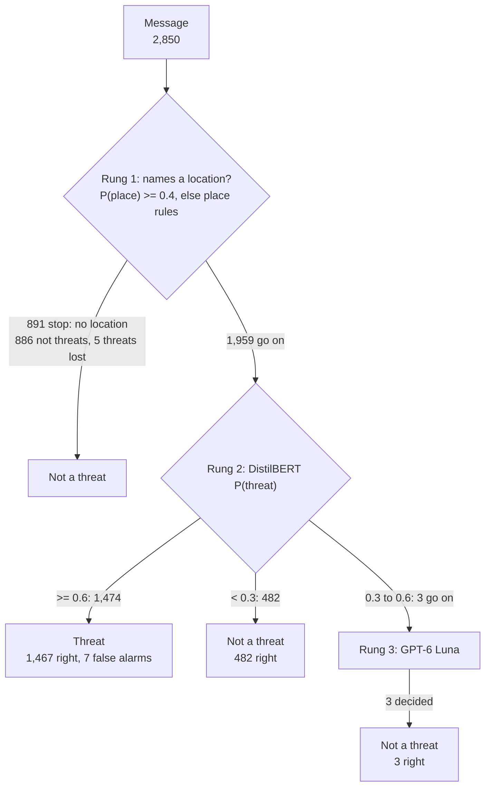

# inference/PhysicalThreatFacility: the physical-threat detector

A message in (a post, alert or article), a verdict out: is it a **physical threat**, a danger or disruption to people or places tied to a real location? No client is needed.
Served by the shared server `../app.py` (see `../README.md`). This folder holds the code and its models (`model/`) and imports nothing from outside `inference/`.

## Use it

| Method | Path | Input |
|---|---|---|
| POST | `/physicalthreat/predict` | JSON: `text` (required), `use_luna` (optional, default true) |

```bash
curl -X POST localhost:8000/physicalthreat/predict -H 'Content-Type: application/json' \
     -d '{"text": "Shots fired near 5th Ave and Pine St, Seattle"}'
```

```json
{"prediction": "threat", "decided_by": "rung2",
 "location": {"found": true, "places": ["5th Ave", "Pine St", "Seattle"], "by": "model"},
 "p_threat": 0.9999, "luna": null, "luna_skipped": null, "timings_ms": {"total": 316}}
```

`decided_by`: `rung1` (no place named), `rung2` (DistilBERT score was clear), `rung3` (Luna answered the unsure ones), `rung2_fallback` (unsure and Luna unavailable: score >= 0.5 decides).
Errors: 400 empty or too long text, 422 missing field.

## Pipeline

Counts are the benchmark test split: 2,850 messages (1,472 threats, 1,378 not).



| Rung | File | Decides when |
|---|---|---|
| 1 | `location.py` | no location found: not a threat (P(place) < 0.4 and no place rule matches) |
| 2 | `threat.py` | P(threat) >= 0.6 threat, < 0.3 not a threat |
| 3 | `luna.py` | the 0.3 to 0.6 band (needs `OPENAI_API_KEY` in `inference/.env`) |

Test confusion matrix:

| | Predicted threat | Predicted not |
|---|---:|---:|
| **Actually a threat** | 1,467 (TP) | 5 (FN) |
| **Actually not** | 7 (FP) | 1,371 (TN) |

Precision 99.53%, recall 99.66%, F1 99.59%. Train and val are not run through the ladder; see `../../development/PhysicalThreatFacility/README.md`.

## What each model receives

| Rung | Model | Input | Output |
|---|---|---|---|
| 1 | MiniLMv2 word tagger | the message with links and @handles removed and hashtags split into words (`#ChicagoScanner` becomes "Chicago Scanner"); first 3,000 characters in pieces of up to 1,000 | for each word, the probability it is part of a place; a message has a location if any word reaches 0.4 |
| 2 | DistilBERT multilingual | the raw message, up to 128 tokens | P(threat) |
| 3 | GPT-6 Luna | the prompt below | JSON: `label`, `subtype`, `confidence`, `reason` |

### Rung 3 prompt (GPT-6 Luna, v14)

The system prompt (about 9,500 characters) is fixed. Its core, in short:

```
You are a security analyst triaging content for a physical-threat monitoring service.
THE RULE: a physical threat = a THREAT + an ANCHOR. The anchor is a pinned-down location OR a named event
that identifies its place. A named person, company, organisation or government on its own is NOT an anchor.
Both parts are needed. Otherwise label 0.
  1. THREAT: violence and crime, terrorism, war, protests and rallies, explosions and bomb threats,
     fires, spills, outages, accidents, severe weather and disasters, public-safety problems ...
  2. ANCHOR: a street, city, state, country or named venue; or a named event that identifies its place.
  Not a threat: fiction, jokes and slang, software outages with no physical effect ...
SUBTYPE: if label is 0 the subtype is "none"; if 1, exactly one of 33 subtypes
  ("structure fires", "gun violence", "protest - organized", "explosions", "police activity", ... "other").
Reply with JSON only.
```

The user message is the text itself, cut to 4,000 characters:

```
TEXT:
Birleşik Devletler posta servisi ' ni dikkate alın .
```

The answer is forced into this JSON shape (`response_schema.json`), temperature 0:

```json
{"label": 0 or 1, "subtype": "<one of the 33, or none>", "confidence": <number>, "reason": "<short text>"}
```

## Setup

No database is used. Model weights are not in git; see `model/README.md` for sizes, checksums and links.
