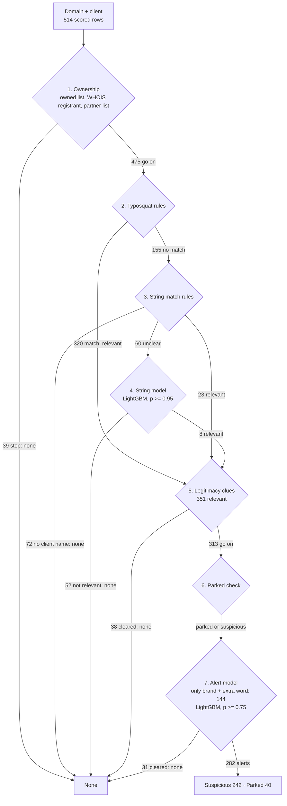

# inference/SuspiciousDomain: the suspicious-domain detector

A domain and a client id in, one class out: `suspicious_domain_registration`, `domains_parked` or `none`.
Served by the shared server `../app.py` (see `../README.md`). This folder holds the code and the two small models (`model/`) and imports nothing from outside `inference/`.
The client and the domain's facts (WHOIS, nameservers, HTTP, page) are read from RDS; no LLM and no GPU are needed.

## Use it

| Method | Path | Input |
|---|---|---|
| GET | `/suspiciousdomain/clients` | none; lists the 10 valid client ids |
| POST | `/suspiciousdomain/predict` | JSON: `client` (an id from `/clients`) and `domain` (a link is cut down to its host). Nothing else |

```bash
curl -X POST localhost:8000/suspiciousdomain/predict -H 'Content-Type: application/json' \
     -d '{"client": "harborbank", "domain": "hraborbank.com"}'
```

```json
{"client": "harborbank", "domain": "hraborbank.com", "prediction": "suspicious_domain_registration", "decided_by": "step 6 parked check",
 "trace": ["typosquat: misspelling (1 edit(s) from 'harborbank' (limit 3 for 10 letters))", "not parked"],
 "facts": {"registrant_org": "REDACTED FOR PRIVACY", "nameservers": ["kate.ns.cloudflare.com", "rob.ns.cloudflare.com"],
           "http_status": 200, "parked_page": false, "page_answered": true, "tranco_rank": null},
 "timings_ms": {"rds": 84, "detect": 0, "total": 84}}
```

`decided_by` names the step that gave the final answer; `trace` lists what each step said.
The domain must have a stored lookup in RDS (`domain_lookups`): the service does not query WHOIS or DNS itself.
Errors: 400 not a domain, 404 unknown client or no stored lookup for the domain, 422 missing field, 503 RDS unavailable.

## Pipeline

Counts are the benchmark test split: 514 scored rows (241 suspicious, 40 parked, 233 not relevant).



| Step | File | Decides when |
|---|---|---|
| 1. Ownership | `ownership.py` | owned list, WHOIS registrant is the client, or listed partner: none |
| 2. Typosquat rules | `typosquat.py` | a lookalike kind matches: relevant |
| 3. String match | `string_match.py` | client name found with a clear meaning: relevant or none |
| 4. String model | `string_model.py`, `model/string_model.txt` | unclear names: relevant at p >= 0.95 |
| 5. Legitimacy | `legitimacy.py` | named other owner with a Tranco rank, or own business name and contact page: none |
| 6. Parked check | `parked.py` | parking nameserver or parking page: parked, else suspicious |
| 7. Alert model | `alert_model.py`, `model/alert_model.txt` | "brand + extra word" alerts: kept at p >= 0.75, else none |

Test confusion matrix:

| | Predicted suspicious | Predicted parked | Predicted none |
|---|---:|---:|---:|
| **Actually suspicious** | 239 | 0 | 2 |
| **Actually parked** | 0 | 40 | 0 |
| **Actually none** | 3 | 0 | 230 |

Accuracy 99.0%. Train and val counts, and how the thresholds were set: `../../development/SuspiciousDomain/README.md`.

## What each model receives

Both models are LightGBM and read the **same 28 numbers**, built from the domain name, the client's profile and the stored facts of the domain. A worked example: `apexclimbinggym.com` for Apex Mutual (an insurer; names `apex`, `apexmutual`; products `ApexShield`, `DriveSure`, `HomeGuard Plus`). The rules cannot settle it ("brand part `apex`; no rule decides"), so the string model scores it: p = 0.00, below 0.95, so it is not relevant.

| Group | Feature | Meaning | `apexclimbinggym.com` |
|---|---|---|---:|
| Client name found | `kind_brand_part`, `kind_product`, `kind_exec_surname` | which kind of client name sits in the domain as whole words | 1, 0, 0 |
| | `surname_and_brand` | an executive's surname and a brand name together | 0 |
| | `term_common` | how common the matched name is as a word (higher is more common) | 3.71 |
| | `term_is_word` | the name is an ordinary word (`apex`) | 1 |
| | `term_len` | length of the matched name | 4 |
| | `coverage` | share of the domain the client names cover | 0.27 |
| | `n_names` | different client names found | 1 |
| The other words | `n_other` | words left over (`climbing`, `gym`) | 2 |
| | `n_sector` | words from the client's industry (insurance, claim, policy ...) | 0 |
| | `n_other_business` | words of another business (gym, dental, bakery ...) | 1 |
| | `n_selling` | selling words (deals, rewards, shop ...) | 0 |
| | `other_common` | average commonness of those words | 4.28 |
| | `n_second_lang` | words in the client's second language | 0 |
| Domain shape | `length`, `hyphens` | letters in the name, hyphens | 15, 0 |
| | `tld_com`, `tld_client` | ends in `.com`; ends in a country ending the client owns | 1, 0 |
| Domain facts | `owner_hidden` | WHOIS owner hidden or empty | 0 |
| | `parked` | parking nameserver or parking page | 0 |
| | `live` | a page answers | 1 |
| | `login_form` | the page has a password box | 0 |
| | `own_business_name`, `contact_page`, `privacy_page` | the page shows its own business name, a contact page, a privacy page | 1, 1, 1 |
| | `links_to_client`, `client_logo` | the page links to the client's site, shows the client's logo | 0, 0 |

Domain age is left out on purpose: in the generated data every squatter is young, so the model would learn "young means threat", which means nothing in a feed of newly registered domains.

What goes into the 28 numbers:

| Input | Where it comes from |
|---|---|
| the domain | the request |
| the client's names | `brand_terms`, `products`, `executives` (RDS) |
| the client's industry and languages | `customers` (RDS) |
| the client's own endings | `customer_domains` (RDS) |
| WHOIS owner, nameservers, HTTP and page facts | `domain_lookups` (RDS) |

The **string model** (Step 4) scores the names the rules call unclear and passes them at p >= 0.95. The **alert model** (Step 7) scores the "brand + extra word" alerts with the same 28 numbers and keeps them at p >= 0.75. No LLM is used.

## Setup

Needs `RDS_HOST`, `RDS_USER`, `RDS_PASSWORD` in the environment or `inference/.env`. Packages: `lightgbm`, `wordfreq`, `wordsegment`, `tldextract`, `psycopg`. About 40 ms per request.

Client data is read from RDS on every request, so changes apply without a restart. To add a client, add its rows:

| Needed | RDS table |
|---|---|
| the client, used by this pipeline | `customers`, `pipeline_metadata` (`susdom`) |
| owned domains (main, regional, defensive) | `customer_domains` |
| the registrant organisation | `domain_ownership` |
| brand names and products | `brand_terms`, `products` |
| executives, partners and resellers | `executives`, `third_parties` |
| a domain's facts | `domain_lookups` (and `tranco_ranks` for popular domains) |

| Path | Contents |
|---|---|
| `model/` | `string_model.txt`, `alert_model.txt`, `thresholds.json` (small, in git) |
| `samples/samples.json` | six test-split domains for `../smoke_test.py` |
