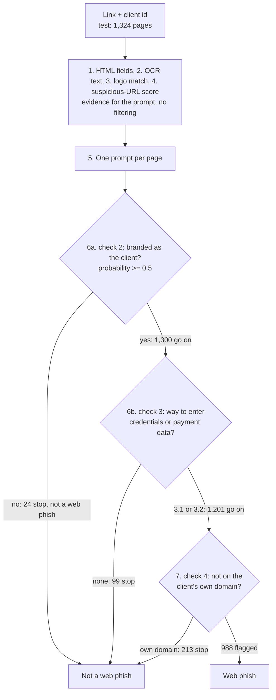

# inference/WebPhish: the web-phish detector

A link and a client id go in; a verdict comes out. It is served by the shared server in `../app.py` (see `../README.md`); this folder holds the code and
its own models (`model/`), and imports nothing from outside `inference/`. Everything about the client and the page is read from RDS (schema `drp_clients`).

## Run

Start the shared server from `inference/` (see `../README.md`). Needs a GPU for speed (about 1 second per link on a T4); `DEVICE=cpu` forces CPU.
The first start also downloads docTR's OCR weights (cached afterwards).

## Use it

```bash
curl localhost:8000/health
curl localhost:8000/webphish/clients
curl -X POST localhost:8000/webphish/predict -H 'Content-Type: application/json' \
     -d '{"client": "paypal", "url": "http://infosantioana.hi2.ro/php/update/"}'
python smoke_test.py            # run from inference/: sends the samples to both incident types
```
`POST /webphish/predict` takes `client` (an id from `/webphish/clients`) and `url` (the link). Errors: 404 unknown client or no stored page for the link, 422 missing field, 503 RDS unavailable.

A link can be stored more than once (207 links have 2 to 7 captures, and the pages differ). With `url`, **every** stored capture is
checked, and the answer says how many records there were and gives a result for each:
```json
{"client": "paypal", "link": "http://carwash.tv/...", "records": 3, "web_phish_records": 0,
 "results": [ {"capture": {"content_id": 30987, "url": "..."}, "prediction": "not_web_phish", "checks": {...}, "signals": {...}, ...},
              {"capture": {"content_id": 31698, ...}, ...}, {"capture": {"content_id": 32128, ...}, ...} ]}
```
A link with one capture returns `records: 1` and one result.

## What happens to one request

| Step | Where | What it does |
|---|---|---|
| 1 | `clients.py` | Reads the client (name, own domains, logos) and the stored page of the link (HTML + screenshot) from RDS |
| 2 | `html_parse.py` | Pulls title, headings, forms, input boxes, links, script URLs and visible text out of the HTML |
| 3 | `ocr.py` | Reads the text on the screenshot (docTR) |
| 4 | `logo.py` | Finds logos on the screenshot (Phishpedia detector) and compares them with the client's logos (Phishpedia matcher) |
| 5 | `url_features.py` + `model/url_model` | Scores how suspicious the URL looks (LightGBM on the host name); shortener links get no score |
| 6 | `prompt.py` | Builds one text from all of the above |
| 7 | `classify.py` | Two fine-tuned mmBERT models read the text: **check 2** branded as the client? **check 3** credential box (3.1), login link (3.2) or none? |
| 8 | `engine.py` | Check 4: is the page off the client's own domain? Combines the checks into the verdict |

**Verdict:** `web_phish` = branded **and** case is 3.1 or 3.2 **and** (not on the client's own domain **or** a form posts to another site).
Otherwise `not_web_phish`. Each result also lists every check's probability, the logo similarity, the URL score, the stored capture used
and the time each step took.

## The pipeline, with counts

Counts are from the benchmark's **test split**: 1,324 stored pages from 25 clients (987 are web phishes, 337 are not). Steps 1 to 4 only collect evidence for every page; the filtering is in steps 5 to 7.



| Step | Stops | Of them wrongly stopped (real web phishes) |
|---|---:|---:|
| check 2 says not branded | 24 | 5 |
| check 3 says none | 99 | 2 |
| check 4 says own domain | 213 | 0 |
| **Flagged as web phish** | **988** | 8 of them are not web phishes |

Final confusion matrix on the test split:

| | Predicted web phish | Predicted not |
|---|---:|---:|
| **Actually web phish** | 980 (TP) | 7 (FN) |
| **Actually not** | 8 (FP) | 329 (TN) |

Precision 99.19%, recall 99.29%. A request sends one link, and the API runs this on every stored capture of it. The full walk-through, with train and val counts, is in `../../development/WebPhish/README.md`.

## Files

| Path | What it is |
|---|---|
| `engine.py`, `clients.py`, `html_parse.py`, `ocr.py`, `logo.py`, `phishpedia_bit.py`, `url_features.py`, `prompt.py`, `classify.py` | The steps above (`settings.py` holds paths and switches) |
| `model/` | `check2/`, `check3/` (epoch 9 models), `phishpedia/` (logo weights), `url_model/` |
| `samples/samples.json` | Four links for the smoke test (two phishing, two benign) |

## Notes
- Nothing is cached between requests: every request reads the client and the page from RDS.
- Checked against the development pipeline on 1,288 test links (those with one stored capture): same branded decision, same data-capture case and same final verdict on all of them; logo similarity within 0.0001; check probabilities within 0.02 (fp16 rounding: one borderline link reads 0.35 here and 0.334 in the batch run). The URL score matches the batch score on all 6,599 scored links.
- Pages parked for sale are not detected here (the benchmark routes them elsewhere).
- Form targets are found with the same rule as the benchmark (a form whose action is on another registered domain), read with lxml.
