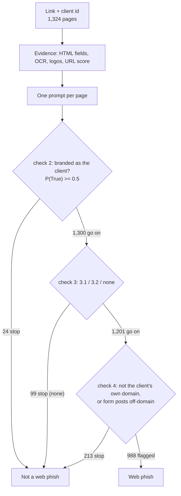

# inference/WebPhish: the web-phish detector

A link and a client id in, a verdict out. Served by the shared server `../app.py` (see `../README.md`). This folder holds the code and its models (`model/`) and imports nothing from outside `inference/`. The client and the stored page are read from RDS.

## Use it

| Method | Path | Input |
|---|---|---|
| GET | `/webphish/clients` | none; lists the valid client ids |
| POST | `/webphish/predict` | JSON: `client` (an id from `/clients`) and `url` (the link). Nothing else |

```bash
curl -X POST localhost:8000/webphish/predict -H 'Content-Type: application/json' \
     -d '{"client": "paypal", "url": "http://infosantioana.hi2.ro/php/update/"}'
```

A link can be stored more than once (207 links have 2 to 7 captures). **Every** stored capture is checked; the answer gives the record count and one result per capture:

```json
{"client": "paypal", "link": "http://carwash.tv/...", "records": 3, "web_phish_records": 0,
 "results": [ {"capture": {"content_id": 30987, "url": "..."}, "prediction": "not_web_phish", "checks": {...}, "signals": {...}}, {...}, {...} ]}
```

Errors: 404 unknown client or no stored page for the link, 422 missing field, 503 RDS unavailable.

## Pipeline

Counts are the benchmark test split: 1,324 stored pages (987 web phishes, 337 not).



| Step | File | What it does |
|---|---|---|
| Read the page | `clients.py` | client and stored page (HTML + screenshot) from RDS |
| HTML | `html_parse.py` | title, headings, forms, links, script URLs, visible text |
| OCR | `ocr.py` | text on the screenshot (docTR) |
| Logos | `logo.py`, `phishpedia_bit.py` | logos on the screenshot compared with the client's |
| URL score | `url_features.py`, `model/url_model` | LightGBM on the host name; shorteners get no score |
| Prompt | `prompt.py` | one text from all of the above |
| check 2, check 3 | `classify.py` | the two mmBERT models |
| check 4, verdict | `engine.py` | own-domain test and the final rule |

Verdict: `web_phish` = branded **and** case 3.1 or 3.2 **and** (not on the client's own domain **or** a form posts to another site). Parked pages are not detected.

Test confusion matrix: TP 980, FP 8, FN 7, TN 329 (precision 99.19%, recall 99.29%). Train/val counts: `../../development/WebPhish/README.md`.

## What each model receives

### Check 2 and check 3 (fine-tuned mmBERT): one text prompt per page

Both models read the same prompt, built from the stored HTML, the screenshot and two scores. A real example (`pos/facebook/0520`, a fake Facebook login):

```
[CLIENT] Facebook
[TITLE] Facebook application
[HEADINGS] wefwfwefwf
[BRAND_HINTS]
[FORMS] action='../../login.php' method=post | input type=text name='email' placeholder='Email or phone' | input type=password name='pass' placeholder='Password'
[SCRIPT_URLS]
[LINKS] button: Log In ->
[VISIBLE_TEXT] wefwfwefwf wefwfwefwf Log In Facebook needs to confirm the following information to allow access to this application videos, Login!
[OCR_TEXT] Email or phone | Password | Login | AFacebook needs to confirm the following information to allow access to this application videos, Login!
[SIGNALS] logo_similarity=unknown p_suspicious_url=0.91
```

| Field | Where it comes from |
|---|---|
| `CLIENT` | the client's display name |
| `TITLE`, `HEADINGS` | the page's title and headings |
| `BRAND_HINTS` | brand clues in the HTML, such as the favicon file name |
| `FORMS` | each form's action and method, and every input (type, name, placeholder) |
| `SCRIPT_URLS` | URLs and redirects found in scripts |
| `LINKS` | link and button texts with their targets |
| `VISIBLE_TEXT` | the text a visitor sees in the HTML |
| `OCR_TEXT` | the text read from the screenshot (docTR), lines joined with `|` |
| `SIGNALS` | `logo_similarity` (best match of a logo on the page to the client's logos, 0 to 1, `unknown` if none) and `p_suspicious_url` (the URL model below; `forwarded` for link shorteners) |

The prompt is limited to 8,192 tokens; if longer, fields are shortened in a fixed order. Check 2 answers `False` / `True`; check 3 answers `3.1` / `3.2` / `none`.

### URL model (LightGBM): 25 numbers from the link's host name only

Its score goes into `SIGNALS`. Example: `http://infosantioana.hi2.ro/php/update/` (only the host `infosantioana.hi2.ro` is used).

| Feature | Meaning | Example |
|---|---|---:|
| `host_len` | characters in the host | 20 |
| `domain_len` | length of the name just left of the ending (`hi2`) | 3 |
| `host_dots` | dots in the host | 2 |
| `subdomain_levels` | labels left of the registered domain | 1 |
| `host_hyphens` | hyphens in the host | 0 |
| `host_digits` | digits in the host | 1 |
| `is_ip` | host is an IP address | 0 |
| `has_port` | link names a port | 0 |
| `punycode` | host has `xn--` (look-alike letters) | 0 |
| `mixed_scripts` | letters from more than one alphabet | 0 |
| `host_entropy` | randomness of the host's letters | 3.27 |
| `tld_len` | length of the ending (`ro`) | 2 |
| `consonant_ratio` | share of consonants | 0.47 |
| `longest_consonant_run` | longest run of consonants | 2 |
| `shared_host` | on a free hosting platform (github.io, weebly.com, ...) | 0 |
| `brand_in_host` | contains a client's brand word but is not that client's own domain | 0 |
| `tld` | the ending as a category | `ro` |
| `tld_risk` | share of phishing links with that ending in training | 0.36 |
| `host_kw_login`, `host_kw_secure`, `host_kw_verify`, `host_kw_account`, `host_kw_update`, `host_kw_support` | host contains the word | 0 |
| `host_kw_count` | how many of 22 risky words the host contains | 0 |

## Setup

Needs the RDS variables in `inference/.env` and a GPU for speed (about 1 s per link on a T4; `DEVICE=cpu` forces CPU). The first start downloads docTR's OCR weights.

| Path | Contents |
|---|---|
| `model/` | `check2/`, `check3/` (epoch 9), `phishpedia/`, `url_model/` (weights are not in git; see `model/README.md`) |
| `samples/samples.json` | four links for `../smoke_test.py` |
