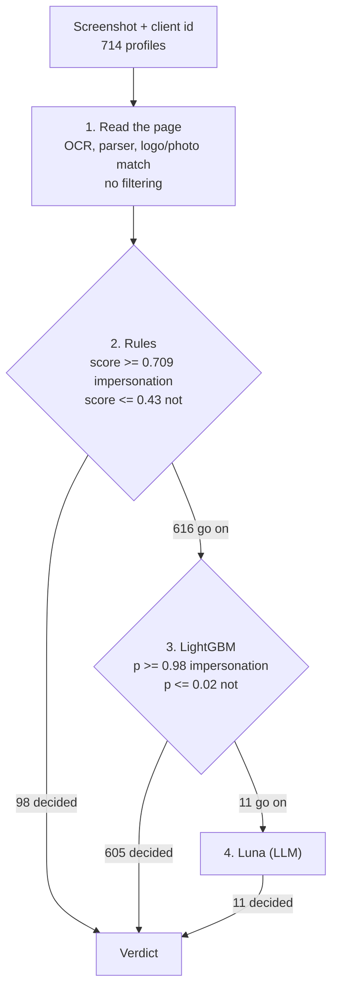

# inference/impersonation: the impersonation detector

One profile screenshot and a client id in, one verdict out (`impersonation` / `not_impersonation`).
Served by the shared server `../app.py` (see `../README.md`). This folder holds the code and the frozen model (`model/frozen.joblib`) and imports nothing from outside `inference/`.

## Use it

| Method | Path | Input |
|---|---|---|
| GET | `/impersonation/clients` | none; lists the valid client ids |
| POST | `/impersonation/predict` | multipart form: `file` (the screenshot), `client` (an id from `/clients`), `use_luna` (optional, default true) |

```bash
curl -F file=@impersonation/samples/imp_p1_apple_0.png -F client=apple http://localhost:8000/impersonation/predict
```

```json
{"prediction": "impersonation", "is_impersonation": true, "decided_by": "rules",
 "client": "apple", "rule_score": 0.84, "ml_probability": 0.99, "luna": null,
 "parsed": {"platform": "X", "display_name": "...", "handle": "...", "link": "...", "followers": 1200},
 "checks": {"avatar_matches_client_logo": true, "avatar_matches_executive_photo": false, "verified_badge": false, "link_on_page": "other domain"},
 "timings_ms": {"total": 240}}
```

`decided_by`: `rules`, `ml` (LightGBM), `luna`, or `ml_fallback` (unsure and Luna unavailable: the model's best guess, lower confidence).
Errors: 400 not an image, 404 unknown client, 413 file too large, 503 RDS unavailable.

## Pipeline

Counts are the benchmark test split: 714 profiles (288 impersonations, 426 not).



| Step | File | Decides when | Decides (test) |
|---|---|---|---:|
| 1. Read | `ocr.py`, `layout_parser.py`, `avatar.py`, `signals.py` | never; makes the 102 numbers | 0 |
| 2. Rules | `rules.py` | score >= 0.709 or <= 0.43 | 98 |
| 3. LightGBM | `features.py` + `model/frozen.joblib` | probability >= 0.98 or <= 0.02 | 605 |
| 4. Luna | `luna.py` | everything still unsure | 11 |

Test confusion matrix: TP 288, FP 0, FN 0, TN 426. Details and train/val counts: `../../development/impersonation/README.md`.

## What each model receives

### Rules and LightGBM: one row of 102 numbers per profile

The screenshot is turned into numbers; nothing else (no HTML, no platform data) is used. A sample row (`imp_p1_apple_0`, a fake "Apple Support" account):

| Name | Handle | Bio | Link | Followers | Logo match | Rule score | LightGBM p | Answer |
|---|---|---|---|---:|---|---:|---:|---|
| Apple Support | applex | Customer service for Apple. Response within mi... | none | 450 | strong | 0.709 | 0.9994 | impersonation |

The 102 features (the rules use the same numbers; LightGBM also gets each rule's points):

| Group | Feature | Meaning |
|---|---|---|
| Name and handle vs brand | `name_brand`, `handle_brand` | fuzzy match (0 to 100) of the display name / handle to the brand; "Acme Support" still matches "Acme" |
| | `name_has_brand`, `handle_has_brand` | 1 if the brand's letters appear inside the name / handle |
| | `name_ratio`, `handle_ratio` | whole-string similarity (0 to 100) to the brand |
| | `name_equals_brand`, `handle_equals_brand` | 1 if identical to the brand |
| Handle shape | `handle_claim` | 1 if it ends like "official", "support", "help", "hq", "billing" |
| | `handle_digits`, `handle_len`, `handle_us` | digit count, length, count of `_` and `.` |
| | `handle_extra` | characters beyond the brand name (-1 if the brand is not in the handle) |
| Bio and posts | `bio_brand`, `post_brand` | brand named in the bio / number of posts naming it |
| | `bio_len`, `no_bio` | bio length, 1 if empty |
| | `n_posts_seen`, `no_posts` | posts visible, 1 if none |
| | `post_name_match` | share of posts written under the profile's own name (-1 if no posts) |
| Banner | `banner_text`, `banner_brand` | banner text present / matches the brand |
| Links | `link_official`, `link_other`, `link_none` | an official-domain link, another domain, or no link |
| | `link_lookalike`, `link_sim` | another domain that contains the brand or is 70%+ like the official domain; the highest such similarity |
| | `link_brand_sub` | the brand sits inside another domain |
| | `link_bio_only` | link appears in the bio but not the link field |
| | `link_field_official`, `link_field_other` | the link field is the official domain / another domain |
| Word lists (22) | `h_*` (name + bio) and `p_*` (posts) for `claim`, `disc`, `own`, `scam`, `hire`, `dm`, `partner`, `role`, `personal`, `employee`, `promo` | how many words of each list appear. `claim` = official, support, care; `disc` = fan, parody, unofficial; `own` = "my own opinions"; `scam` = giveaway, crypto, refund; `hire` = careers; `dm` = DM us, WhatsApp; `partner` = reseller, agency; `role` = CEO, director; `personal` = hobbies, family; `employee` = works at; `promo` = discount |
| | `disc_any`, `scam_any` | 1 if a disclaimer / scam word appears anywhere |
| Executives | `exec_name`, `exec_name_exact` | best similarity of the name to a protected executive; 1 if 92+ |
| | `exec_role_bio`, `exec_role_any`, `exec_brand_bio` | bio holds that executive's role / any executive title / the brand name |
| Profile picture | `av_logo_clip`, `av_logo_ncc` | match to the client logo (CLIP and pixel correlation) |
| | `av_exec_clip`, `av_exec_ncc` | match to the executive photos |
| | `av_sil_clip`, `av_sil_ncc` | match to the generic default silhouette |
| | `av_av_sat`, `av_av_std`, `av_av_mean` | colourfulness, contrast, brightness of the picture |
| | `av_logo_strong`, `av_exec_strong`, `av_default` | 1 if the logo (ncc > 0.5 or clip > 0.9), executive photo (ncc > 0.70 or clip > 0.80) or silhouette (ncc > 0.7) matches |
| Account | `followers`, `following`, `posts_n` | counts shown (-1 if not shown; LinkedIn connections count as followers) |
| | `age_months`, `log_followers`, `foll_ratio` | account age, log of followers, followers per following |
| | `verified` | 1 if a verified badge is found in the header |
| Rule points (21) | `r_name_brand` +2, `r_typo_name` +1.5, `r_handle` +1, `r_logo` +2.5, `r_logo_weak` +1, `r_claim` +1.5, `r_link_look` +2, `r_banner` +1, `r_dm` +0.5, `r_exec_name` +2, `r_exec_photo` +2.5, `r_exec_bio` +1.5 | points toward impersonation (the value shown is the maximum) |
| | `n_scam` -4, `n_verified` -4, `n_disc` -2.5, `n_own` -2, `n_partner` -1.5, `n_link_official` -1.5, `n_personal` -1, `n_egg` -1.5, `n_young_nothing` -0.5 | points against (scam pages are another incident type) |
| Totals | `rule_score` | all points added, rescaled to 0 to 1 |
| | `plat_code` | platform as a number (X 0, Facebook 1, Instagram 2, LinkedIn 3, Telegram 4, TikTok 5) |

### Luna: the screenshot and a short fact sheet

Luna sees only the pages the first two stages left unsure. Instructions (summary): decide whether the account pretends to *be* the client or one of its protected executives; fan, parody, partner, namesake, personal and scam accounts are not impersonation. Input for the sample above:

```
## 1. Client
{"name": "Apple", "official_domain": "apple.com", "protected_executives": [{"name": "...", "role": "..."}, ...]}

## 3. Automated checks
{"avatar_matches_client_logo": true, "avatar_matches_protected_executive_photo": false,
 "verified_badge_detected": false, "link_on_page": "none"}

[client's official logo image]   [screenshot of the profile image]
```
Answer: one choice, `impersonation` or `not_impersonation`, with its probability.

## Setup

Needs `RDS_HOST`, `RDS_USER`, `RDS_PASSWORD` (and optionally `OPENAI_API_KEY` for Luna) in the environment or `inference/.env`. A GPU is used when available (about 0.3 s per page; about 4 s on CPU).

| Variable | Default | Meaning |
|---|---|---|
| `OPENAI_API_KEY` | none | Luna key; without it unsure pages use `ml_fallback` |
| `LUNA_ENABLED` | `1` | `0` turns Luna off |
| `LUNA_MODEL`, `LUNA_TIMEOUT_S` | `gpt-6-luna`, `60` | model and per-call timeout |
| `DEVICE` | `auto` | `cpu` forces CPU |
| `MAX_UPLOAD_MB` | `10` | upload limit |
| `RDS_PORT`, `RDS_DBNAME`, `RDS_SSLMODE`, `RDS_SCHEMA` | `5432`, `customerdata`, `require`, `drp_clients` | connection details |

Client data is read from RDS on every request, so changes apply without a restart. To add a client, add its rows:

| Needed | RDS table |
|---|---|
| the client, used by this pipeline | `customers`, `pipeline_metadata` (`impersonation`) |
| brand, official domain | `customers`, `customer_domains` (type `main`) |
| protected executives | `executives` |
| logo and executive photos | `assets` |
| their CLIP vectors | `impersonation_embeddings` |
